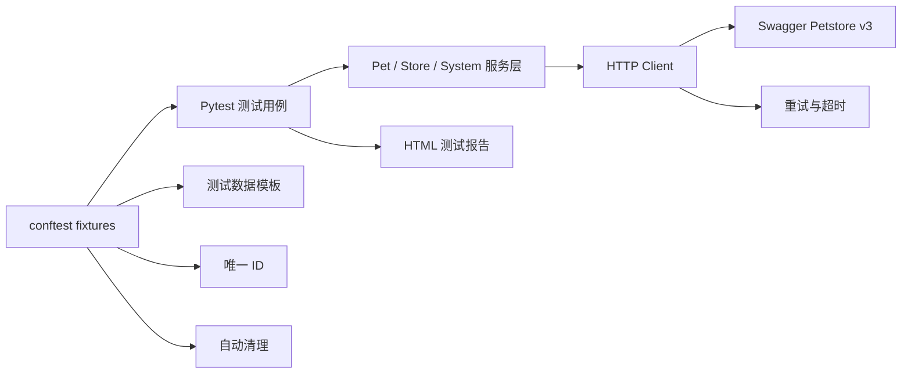

# Swagger Petstore API Test Framework

[](https://github.com/ri-ce/petstore-api-test-framework/actions/workflows/api-tests.yml)


基于 **Swagger Petstore 官方公开 REST API** 的接口自动化测试项目。被测对象不是本项目自行编写的
业务服务，而是真实在线的 [Swagger Petstore v3](https://petstore3.swagger.io/) 开源示例系统。

项目围绕 OpenAPI 契约、宠物 CRUD、状态查询、库存查询和订单生命周期设计自动化用例，
并使用唯一测试 ID、网络重试和自动清理机制降低公共演示环境变化带来的影响。

## 项目结果

| 指标 | 结果 |
| --- | --- |
| 被测系统 | Swagger Petstore v3 公网 REST API |
| 自动化用例 | 22 条 |
| 用例通过率 | 22 / 22 |
| 本机执行耗时 | 68.49 秒 |
| 覆盖范围 | OpenAPI 契约、宠物 CRUD、状态查询、库存、订单生命周期 |
| 持续集成 | GitHub Actions |
| 测试报告 | Pytest HTML 自包含报告 |

最近一次本地实测：2026-10-21，Windows 11、Python 3.14.7、Pytest 9.1.1。

## 为什么选择真实公开 API

- 被测系统由 Swagger 官方维护，不是自己编写的演示服务。
- 测试基于公开的 OpenAPI 规范，可以直接验证接口契约。
- 创建、查询、修改和删除使用真实 HTTP 请求。
- 唯一 ID、清理夹具和重试机制可以展示对外部依赖的测试可靠性设计。
- 面试时可以明确区分为“个人测试框架”和“第三方被测系统”。

## 自动化覆盖场景

- OpenAPI 文档可访问且符合 OpenAPI 3 格式。
- 文档包含宠物和订单业务路径及 CRUD 方法。
- 按 `available`、`pending`、`sold` 三种状态查询宠物。
- 创建宠物并校验名称、分类、标签和状态。
- 查询刚创建的宠物并比对完整业务字段。
- 修改宠物后再次查询，验证数据真实写入。
- 删除宠物后查询返回 `404`。
- 不存在的宠物返回 `404`，非法 ID 类型返回 `400`。
- 查询库存状态映射并校验数据类型。
- 创建订单、查询订单、删除订单及删除后查询。
- 不存在的订单返回 `404`。

## 技术设计



可靠性设计：

- `requests.Session` 复用 HTTP 连接。
- `HTTPAdapter + Retry` 对连接异常、超时和临时服务端错误进行有限重试。
- 每轮测试使用随机唯一 ID，避免与公共环境中的其他用户冲突。
- `created_pet` 和 `created_order` 夹具在用例结束后自动删除测试数据。
- `/openapi.json` 作为契约来源，测试前确认目标接口和 HTTP 方法存在。

## 快速运行

Windows PowerShell：

```powershell
cd petstore-api-test-framework
.\run_tests.ps1
```

手动运行：

```powershell
python -m venv .venv
.\.venv\Scripts\Activate.ps1
python -m pip install -r requirements.txt
python -m pytest --html=reports/report.html --self-contained-html
```

只执行核心冒烟用例：

```powershell
python -m pytest -m smoke
```

如需切换到 Swagger Petstore 的其他部署地址：

```powershell
$env:PETSTORE_BASE_URL = "https://petstore3.swagger.io/api/v3"
python -m pytest
```

## 目录结构

```text
petstore-api-test-framework/
├── api/
│   └── client.py              # HTTP 客户端与接口服务层
├── data/
│   └── test_data.json         # 宠物和订单测试数据模板
├── docs/
│   ├── index.html             # GitHub Pages 项目主页
│   ├── test-report.html       # 最近一次测试报告快照
│   ├── 测试计划.md
│   ├── 测试用例清单.md
│   └── 面试讲解.md
├── reports/                   # 本地报告输出目录
├── tests/
│   ├── test_contract.py       # OpenAPI 契约测试
│   ├── test_pet.py            # 宠物业务测试
│   └── test_store.py          # 库存与订单测试
├── conftest.py                # 测试数据、唯一 ID 和自动清理
├── pytest.ini
├── requirements.txt
└── run_tests.ps1
```

## 简历写法

```text
个人项目：Swagger Petstore 接口自动化测试框架
技术栈：Python / Pytest / Requests / OpenAPI / GitHub Actions

- 基于 Swagger Petstore 官方公开 REST API 设计接口自动化测试，
  使用 service 层封装系统、宠物和订单接口，并通过 OpenAPI 文档进行契约校验。
- 设计并执行 22 条自动化用例，覆盖宠物 CRUD、状态查询、库存查询、
  订单创建与删除、404/400 异常响应等场景。
- 使用随机唯一 ID、自动清理夹具、超时和重试机制降低公共环境干扰；
  接入 GitHub Actions 与 HTML 测试报告，全部用例执行通过。
```

## 项目边界

Swagger Petstore 是公开测试服务，不是企业生产系统。公共环境可能被其他用户共同修改，
也可能出现短时网络波动。本项目通过重试、唯一 ID 和清理机制提高稳定性，但不会把公开演示
服务描述成企业项目。当前测试重点是宠物与订单业务，不覆盖用户管理模块。
