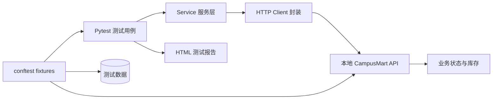

# CampusMart API Test Framework

[](https://github.com/ri-ce/campusmart-api-test-framework/actions/workflows/api-tests.yml)


一个用于软件测试岗位求职展示的接口自动化测试项目。项目以“校园二手交易平台”为业务背景，
包含一个可独立运行的本地演示 API，以及分层封装的接口自动化测试框架。

> 被测 API 是为测试演示而编写的本地服务，不是企业生产系统。项目重点是测试分析、
> 接口框架设计和异常场景覆盖，所有结果均可本地复现。

## 项目结果

| 指标 | 结果 |
| --- | --- |
| 自动化用例 | 53 条 |
| 用例通过率 | 53 / 53 |
| 本机执行耗时 | 2.78 秒 |
| 覆盖模块 | 登录鉴权、商品管理、查询筛选、权限控制、订单与库存 |
| 持续集成 | GitHub Actions |
| 测试报告 | Pytest HTML 自包含报告 |

本地实测环境：Windows 11、Python 3.14.7、Pytest 9.1.1。

## 自动化覆盖场景

- 登录成功、密码错误、参数缺失、非 JSON 请求体。
- Token 鉴权和退出登录后 Token 失效。
- 商品列表、分类筛选、价格区间、关键词查询及非法筛选参数。
- 商品发布、查询、修改、删除和字段校验。
- 卖家、买家、管理员之间的越权访问控制。
- 下单成功、自购拦截、库存不足、非法购买数量。
- 订单查询、取消订单、重复取消。
- 取消订单后恢复库存、售罄商品不可再下单。
- 商品存在待处理订单时禁止删除。

## 技术设计



分层职责：

- `tests/`：业务场景与断言，关注“测试什么”。
- `api/client.py`：HTTP 会话、Token 管理和业务接口封装。
- `conftest.py`：启动被测服务、重置状态、登录并生成测试数据。
- `data/`：测试数据与账号配置。
- `app/`：可独立运行的演示 API，用于稳定复现测试过程。

## 快速运行

Windows PowerShell：

```powershell
cd campusmart-api-test-framework
.\run_tests.ps1
```

或者手动运行：

```powershell
python -m venv .venv
.\.venv\Scripts\Activate.ps1
python -m pip install -r requirements.txt
python -m pytest --html=reports/report.html --self-contained-html
```

只执行核心冒烟用例：

```powershell
python -m pytest -m smoke
```

## 单独启动演示 API

```powershell
.\run_api.ps1
```

服务地址为 `http://127.0.0.1:5000`，健康检查：

```text
GET /health
```

主要接口：

| Method | Path | Description |
| --- | --- | --- |
| POST | `/api/auth/login` | 登录并获取 Token |
| POST | `/api/auth/logout` | 注销当前 Token |
| GET | `/api/listings` | 查询和筛选商品 |
| POST | `/api/listings` | 发布商品 |
| PATCH | `/api/listings/{id}` | 修改商品 |
| DELETE | `/api/listings/{id}` | 删除商品 |
| POST | `/api/orders` | 创建订单 |
| GET | `/api/orders/{id}` | 查询订单 |
| POST | `/api/orders/{id}/cancel` | 取消订单并回滚库存 |

演示账号：

| Role | Username | Password |
| --- | --- | --- |
| Seller | `alice` | `Seller123!` |
| Buyer | `bob` | `Buyer123!` |
| Admin | `admin` | `Admin123!` |

## 目录结构

```text
campusmart-api-test-framework/
├── api/                       # HTTP 客户端与业务接口封装
├── app/                       # 本地演示 API
├── data/                      # 测试账号和测试数据
├── docs/                      # 测试计划、用例清单、面试讲解
├── reports/                   # 测试报告输出目录
├── tests/                     # 自动化测试用例
├── conftest.py                # 服务与数据 fixtures
├── pytest.ini                 # Pytest 配置和自定义标记
├── requirements.txt
├── run_api.ps1
└── run_tests.ps1
```

## 简历写法

```text
个人项目：CampusMart 接口自动化测试框架
技术栈：Python / Pytest / Requests / Flask / GitHub Actions

- 独立搭建接口自动化测试框架，封装 HTTP 会话、业务接口和测试数据层，
  使用 fixture 自动启动被测服务并隔离测试状态。
- 围绕登录、商品、权限与订单库存流程设计 53 条自动化用例，覆盖正常流程、
  参数校验、越权访问、库存不足、重复取消等场景。
- 使用参数化处理等价类和边界值场景，接入 Pytest HTML 报告与 GitHub Actions，
  本地执行 53 条用例全部通过，耗时 2.78 秒。
```

## 使用边界

这个项目用于学习和求职展示。演示 API 使用内存存储和明文密码，不具备生产环境的
安全、持久化和高可用能力，因此不能直接用于真实业务。
