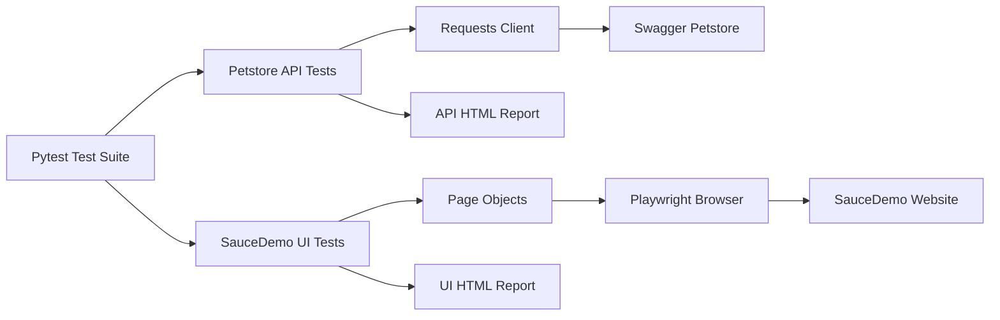

# Software Testing Automation Portfolio

[](https://github.com/ri-ce/qa-automation-portfolio/actions/workflows/tests.yml)


一个面向软件测试岗位的个人自动化测试作品集，包含两个互补项目：

1. **Swagger Petstore 接口自动化测试**：验证第三方公开接口的契约、CRUD、状态查询和订单流程。
2. **SauceDemo 网页自动化测试**：使用真实浏览器执行登录、商品排序、购物车和结算流程。

两个项目的被测系统均为第三方公开测试环境，不是本项目自行编写的企业业务系统。

## 项目结果

| 项目 | 类型 | 用例数 | 本机结果 | 耗时 |
| --- | --- | ---: | ---: | ---: |
| Swagger Petstore | 接口自动化 | 22 | 22 / 22 通过 | 68.49 秒 |
| SauceDemo | 网页自动化 | 12 | 12 / 12 通过 | 19.40 秒 |
| 合计 | 接口 + 网页 | 34 | 34 / 34 通过 | 约 88 秒 |

最近一次本地实测：2026-10-21，Windows 11、Python 3.14.7。

## 项目一：Swagger Petstore 接口测试

被测系统：`https://petstore3.swagger.io/api/v3`

技术栈：Python、Pytest、Requests、OpenAPI。

覆盖内容：

- OpenAPI 文档和业务路径契约校验。
- 宠物创建、查询、修改和删除。
- 宠物 available、pending、sold 状态查询。
- 库存状态映射查询。
- 订单创建、查询和删除。
- 不存在资源返回 404，非法 ID 类型返回 400。
- 随机唯一 ID、自动数据清理、超时和网络重试。

项目报告：[Petstore 测试报告](docs/test-report.html)

## 项目二：SauceDemo 网页测试

被测网站：`https://www.saucedemo.com/`

技术栈：Python、Pytest、Playwright、Page Object。

覆盖内容：

- 登录页面加载。
- 标准用户正常登录。
- 错误密码和锁定账号提示。
- 登录后退出。
- 商品列表数量。
- 商品价格与名称排序。
- 加入和移除购物车。
- 购物车商品展示。
- 结算表单必填校验。
- 完整订单结算。
- 失败自动截图。

项目报告：[SauceDemo 测试报告](docs/saucedemo-ui-report.html)

## 技术设计



设计原则：

- 测试场景与底层请求或页面操作分离。
- 接口资源使用唯一 ID，测试后自动删除。
- 网页测试使用页面对象，页面变化时集中维护。
- 每个网页用例使用独立浏览器上下文，避免状态污染。
- 使用显式等待和业务结果断言，不依赖固定睡眠时间。
- 两个项目分别生成 HTML 报告，由 GitHub Actions 自动执行。

## 快速运行

运行全部 34 条测试：

```powershell
.\run_tests.ps1
```

只运行接口测试：

```powershell
.\run_api_tests.ps1
```

只运行网页测试：

```powershell
.\run_ui_tests.ps1
```

首次在本地运行网页测试时，Playwright 优先使用已安装的 Chrome 浏览器。
在 GitHub Actions 中会安装独立的 Chromium 浏览器。

目录结构

```text
qa-automation-portfolio/
├── api/                       # Petstore HTTP 客户端与服务层
├── data/                      # 接口测试数据模板
├── tests/                     # 22 条接口测试
├── ui_tests/
│   ├── pages/                 # Login、Inventory、Cart、Checkout 页面对象
│   ├── conftest.py            # 浏览器初始化与失败截图
│   ├── test_login.py          # 登录与退出测试
│   ├── test_catalog.py        # 商品与排序测试
│   └── test_cart_checkout.py  # 购物车与结算测试
├── docs/
│   ├── index.html             # 合并后的作品集主页
│   ├── petstore-api.html      # 接口项目详情
│   ├── saucedemo-ui.html      # 网页项目详情
│   ├── test-report.html       # 接口测试报告
│   └── saucedemo-ui-report.html
├── conftest.py                # 接口测试 fixtures
├── requirements.txt
├── run_tests.ps1
├── run_api_tests.ps1
└── run_ui_tests.ps1
```


接口项目：

```text
基于 Swagger Petstore 公开 API 完成接口自动化测试，使用 Pytest 和 Requests
搭建服务层，覆盖 OpenAPI 契约、宠物 CRUD、状态筛选、库存与订单生命周期，
共执行 22 条用例。通过随机唯一 ID、自动清理和网络重试提升公共 API 测试稳定性。
```

网页项目：

```text
基于 SauceDemo 公开商城完成 Playwright 网页自动化测试，采用 Page Object
封装登录、商品、购物车和结算页面，覆盖正常登录、异常账号、排序、购物车
和完整下单流程，共执行 12 条用例，并支持等待、超时和失败自动截图。
```

作品集综合写法：

```text
完成接口与网页自动化测试作品集，使用 Python、Pytest、Requests 和 Playwright
设计 34 条自动化用例，覆盖接口契约、CRUD、异常响应、网页交互和端到端结算流程；
使用数据隔离、自动清理、页面对象和显式等待提升可维护性，并通过 GitHub Actions
实现持续集成与自动化回归。
```

## 使用边界

Swagger Petstore 和 SauceDemo 都是公开测试演示环境。项目展示的是测试框架、测试分析和
自动化执行能力，不代表企业生产项目，也不包含企业真实数据。
